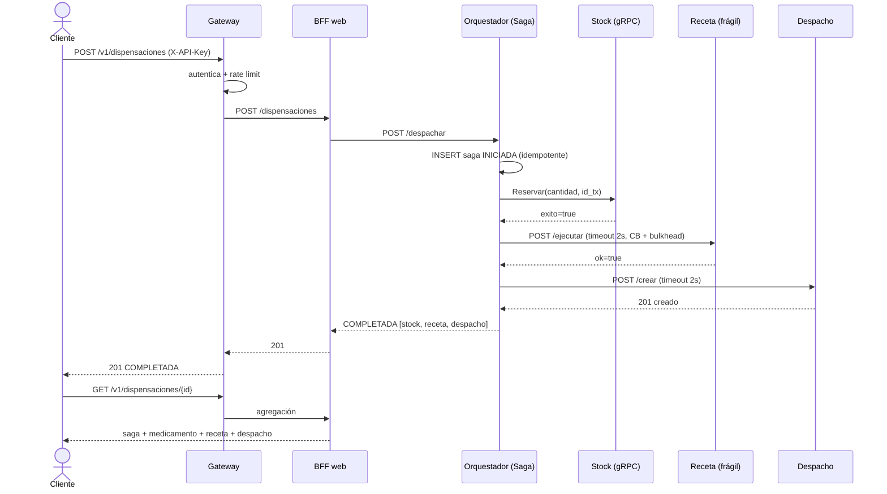
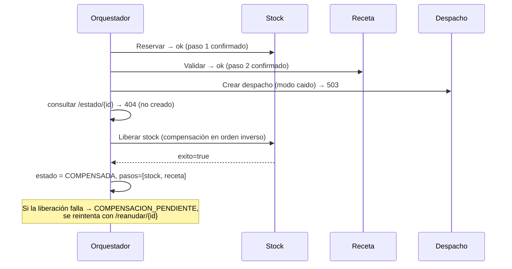
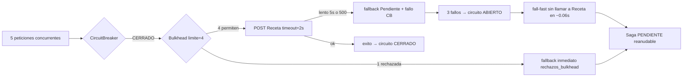

# Informe — Encargo integrador Unidad 3, Forma J (Farmacia)

**Dominio:** despacho de una receta. **Patrones:** Gateway + BFF, Saga orquestada,
timeout, Circuit Breaker, Bulkhead y degradación elegante.

## 1. Decisiones de arquitectura

| Decisión | Justificación | Dónde se ve |
|---|---|---|
| **Saga, no 2PC** | 2PC es bloqueante: si el coordinador cae tras preparar, los participantes quedan *in-doubt* con recursos bloqueados. Aquí hay servicios autónomos con BD separadas y un validador externo lento; se prefiere consistencia eventual y disponibilidad. | [`ADR/ADR-001.md`](../ADR/ADR-001.md) |
| **Orquestación, no coreografía** | Un director central con estado persistido da visibilidad del flujo, control exacto del orden inverso de compensaciones y facilita la reanudación. | `orquestador/saga.py`, `orquestador/bd.py` |
| **Gateway sin lógica de negocio** | Solo enruta, autentica (`X-API-Key`) y limita (5 req / 10 s). Los servicios internos confían en la puerta y no se exponen. | `gateway/app.py` |
| **BFF por cliente (web)** | Compone en una sola respuesta datos de 4 servicios (Saga, Stock, Despacho, Receta) y delega la operación al orquestador. | `bff_web/agregacion.py`, `bff_web/clientes.py` |
| **Idempotencia** | Clave `id_dispensacion`: índice único en `movimientos` de Stock, `INSERT OR IGNORE` en `sagas` y `despachos`. Repetir reserva, liberación o saga no duplica efectos. | `stock/bd_stock.py`, `orquestador/bd.py`, `despacho/bd.py`, tests de idempotencia |
| **Timeout en toda llamada** | Gateway 3 s, BFF 3 s, Stock gRPC 3 s, Receta 2 s, Despacho 2 s. Ninguna dependencia puede colgar al sistema. | `gateway/app.py`, `bff_web/clientes.py`, `orquestador/clientes.py` |
| **Compensación** | Paso 1 (Stock) → liberar; paso 2 (Receta) sin compensación según el enunciado (solo validación); paso 3 (Despacho) → cancelar. Como Despacho es el último paso, al fallar no hay despacho creado que cancelar: se compensa hacia atrás liberando Stock. | `orquestador/saga.py:_compensar`, `despacho/app.py:/cancelar` |

## 2. Diagramas

### 2.1 Camino feliz



### 2.2 Fallo en el último paso → compensación inversa



### 2.3 Falla en cascada contenida (Receta lenta/caída + pico)



## 3. Evidencia: antes y después

Fuente completa: [`evidencia/antes-despues.txt`](evidencia/antes-despues.txt) y
[`evidencia/salida-verificacion.txt`](evidencia/salida-verificacion.txt). Scripts
reproducibles: [`evidencia/medir_antes_despues.py`](evidencia/medir_antes_despues.py) y
[`evidencia/verificar_e2e.py`](evidencia/verificar_e2e.py).

| Momento | Circuito | Llamadas a Receta | Métricas clave | Resultado observable |
|---|---|---|---|---|
| **Antes** (reset) | CERRADO, 0 fallos | 0 | todo en 0 | línea base limpia |
| **Antes** (petición sana) | CERRADO | 1 | `exitos=1`, `fallbacks=0` | `COMPLETADA`, 3 pasos |
| **Después** (Receta caída ×3) | **ABIERTO**, 3 fallos | 4 | `fallbacks=3`, `aperturas=1`, `timeouts=0` | 3 Sagas `PENDIENTE` con `["stock"]` |
| **Después** (4ª petición, circuito abierto) | ABIERTO | **sigue en 4** | `fallbacks=4`, `llamadas=4` | `201 PENDIENTE` en **0.060 s** (fail-fast) |
| **Pico** (5 concurrentes, Receta lenta) | ABIERTO | 4 | `timeouts=4`, `rechazos_bulkhead=1`, `fallbacks=5`, `aperturas=2` | 5 Sagas `PENDIENTE`, sin cascada |
| **Compensación** (Despacho caído) | CERRADO | — | Receta sana: `exitos=1`, `fallos=0` | `COMPENSADA` `["stock","receta"]`, stock 42 uds. |

La lectura de métricas se hace con:

```bash
docker compose exec -T orquestador python -c "import urllib.request; print(urllib.request.urlopen('http://localhost:8104/admin/resiliencia').read().decode())"
```

## 4. Interpretación: qué habría pasado sin el patrón

- **Sin Circuit Breaker:** cada petición seguiría intentando validar contra un servicio caído.
  En modo `caido` serían 500 propagados; en modo `lento`, 5 s de espera por petición contra
  un timeout de 2 s. Con CB, la 4ª petición se resolvió en **0.060 s** y `llamadas` no aumentó:
  la falla quedó contenida y la Saga se persistió como `PENDIENTE`, reanudable.
- **Sin Bulkhead:** los 5 hilos concurrentes habrían entrado a la dependencia lenta y agotado
  la capacidad del orquestador. Con límite 4, una petición fue rechazada de inmediato
  (`rechazos_bulkhead=1`) sin saturar Receta; el resto del sistema siguió respondiendo.
- **Sin_timeout:** el modo lento (5 s) habría colgado cada petición y el gateway (timeout 3 s)
  habría devuelto 503. El timeout de 2 s permite degradar a `PENDIENTE` sin pérdida del estado.
- **Sin Saga/compensación:** al fallar Despacho, la reserva de Stock quedaría consumida sin
  entrega. La compensación inversa libera el stock: el `GET` agregado muestra `despacho: 404`
  y `MED-1` con 42 unidades (50 iniciales menos reservas confirmadas).
- **Sin idempotencia:** reenviar `Reservar`/`Liberar` o reanudar dos veces descontaría o
  repondría unidades de más. El índice único en `movimientos` y `INSERT OR IGNORE` evitan el
  doble efecto (ver tests `test_bd_stock_idempotencia`, `test_bd_despacho`).

## 5. Estado frente a la rúbrica

| Requisito | Estado |
|---|---|
| Tres servicios de dominio con BD propia | Cumplido (Stock, Receta, Despacho + BD de la Saga). |
| Gateway único punto de entrada: ruteo, auth, rate limit | Cumplido y verificado (401/429/200). |
| BFF que agrega ≥2 servicios | Cumplido (4 bloques en `GET /v1/dispensaciones/{id}`). |
| Saga justificada vs 2PC; orquestación justificada | Cumplido en ADR-001 y §1. |
| Compensación en orden inverso y pasos idempotentes | Cumplido; verificado con Despacho caído y tests. |
| Timeout / CB con fallback / Bulkhead | Cumplido y medido (§3). |
| Escenarios obligatorios: éxito, compensación, cascada contenida | Cumplidos (16/16 comprobaciones). |
| Antes/después e interpretación de métricas | Cumplido (§3 y §4). |
| `docker compose up` y README con escenarios | Cumplido (README raíz; compose corregido en esta sesión). |
| Informe ≤ 8 páginas con diagramas | Cumplido (este documento). |
| Commits identificables por integrante | Cumplido (Matygp, YinYanCat, Emyowo204). |
| Video ≤ 8 min con todos los integrantes | **Pendiente** (entregable externo al repo). |
| Defensa oral | **Pendiente** (se evalúa en vivo; puede subir/bajar la nota). |

**Observación para la defensa:** el servicio Despacho expone `/cancelar`, pero no se invoca
porque es el último paso de la Saga (si falla, no existe despacho que cancelar). Receta expone
`/compensar`, pero el enunciado indica que la validación no tiene compensación; por eso la
compensación inversa efectiva es solo la liberación de stock. El material de la unidad menciona
*retry con backoff*; la implementación usa reanudación explícita (`/reanudar/{id}`) en vez de
reintentos automáticos, decisión coherente con dejar la Saga `PENDIENTE` y reanudarla cuando
la dependencia vuelve.
